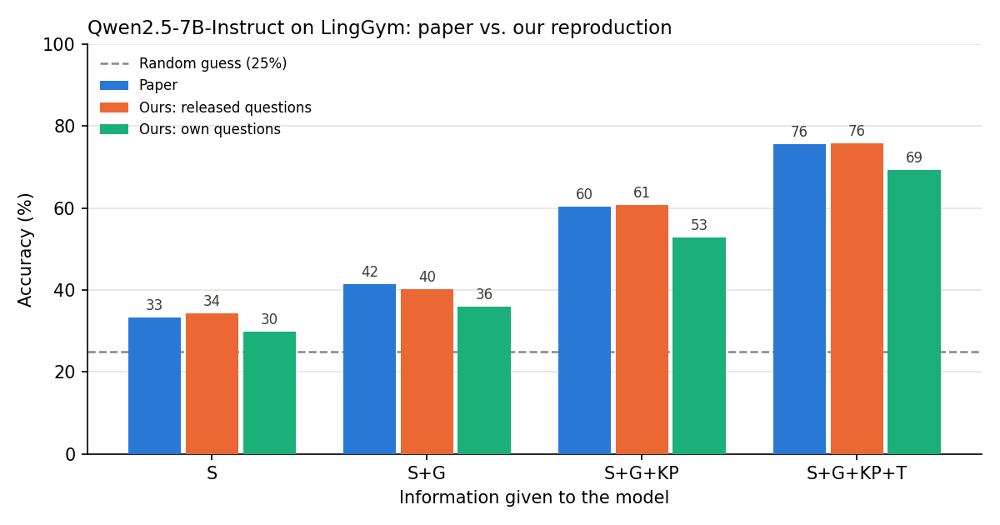

# LingGym reproduction

Thanush Dinesh, CSCI3052U Machine Learning, individual assignment (hacker & implementer).

**Video presentation:** https://drive.google.com/file/d/1Vd31ur6CU9hPJfzFkcRl4xl-IwZM9zj9/view?usp=sharing

Reproduction of Yang, Ma, Shi & Zhu, *LingGym: How Far Are LLMs from Thinking Like Field Linguists?*, EMNLP 2025 ([paper](https://aclanthology.org/2025.emnlp-main.69/), [authors' repo](https://github.com/changbingY/LingGym)).

LingGym takes example sentences from 18 grammar books, hides one word, and asks an LLM to pick the right word + gloss from 4 options. The model gets more hints each time: sentence only (S), + gloss (G), + grammar explanation (KP), + English translation (T). In the paper Qwen2.5-7B goes 33% → 42% → 56% → 71% (chance is 25%).

What I did:
- Exp 1: ran Qwen2.5-7B (4-bit, free Colab T4) on a seeded sample of the authors' questions: 150 each from Pichi, Papuan Malay and Kalamang.
- Exp 2: wrote my own question generator (`src/question_gen.py`) and ran the same model on its questions.
- Exp 3: re-ran the paper's sampling setup on 150 questions to check my scoring shortcut.
- Exp 0: random baseline.


## Repo layout

```
notebook/linggym_reproduction.ipynb   runs everything
src/
  seed.py           seeds
  data.py           loads the authors' questions
  question_gen.py   my question generator
  prompts.py        prompt for each hint level
  evaluate.py       model loading and scoring
  experiment.py     runs one experiment
  analysis.py       accuracy, CI, comparison with the paper
data/processed/     the questions I evaluated
results/            one folder per experiment + comparison CSVs
results/reference/  the paper's numbers (Table 3, Appendix B)
figures/            pipeline (draw.io) and results chart
```

## How to run

Colab (what I used):
1. Open `notebook/linggym_reproduction.ipynb` in Colab (File → Open notebook → GitHub).
2. Runtime → Change runtime type → T4 GPU.
3. Run all. The first cell clones this repo and installs `requirements-colab.txt`.

A full run takes about 40 minutes. The saved predictions in `results/` are reused, so a rerun finishes the experiments almost straight away. Delete a `results/<run>/predictions.csv` to redo that experiment.

Locally (NVIDIA GPU, 12 GB+):
```bash
pip install -r requirements.txt
jupyter notebook notebook/linggym_reproduction.ipynb
```

Settings (seed, languages, sample size, model, 4-bit or not) are in the second cell of the notebook.

Each notebook section and what it produces:

| Section | Output |
|---|---|
| Part 1 | `data/processed/released_sample.jsonl` |
| Part 2 | `data/processed/own_questions.jsonl` |
| Part 4 | `results/exp0_random/`, `exp1_released_qwen7b/`, `exp2_own_qwen7b/`, `exp3_released_qwen7b_sampling/` |
| Part 5 | `results/comparison.csv`, `figures/results_vs_paper.png` |

Reproducibility: seeds are fixed for random, numpy and torch (`src/seed.py`), the authors' data is pinned to commit `ce6059b`, library versions are in `requirements.txt`, and every run saves its config and environment in `results/<run>/`.

## Results

Accuracy (%). "Paper (matched)" is the paper's Appendix B number for the same 3 languages.

| Level | Paper (all 18) | Paper (matched) | Exp 1 | Δ | Exp 2 | Δ | Random |
|---|---|---|---|---|---|---|---|
| S | 33.0 | 33.4 | 34.2 | +0.9 | 29.9 | −3.5 | 26.9 |
| S+G | 41.6 | 41.5 | 40.2 | −1.3 | 35.9 | −5.6 | 26.4 |
| S+G+KP | 56.1 | 60.4 | 60.7 | +0.3 | 52.9 | −7.5 | 22.2 |
| S+G+KP+T | 71.1 | 75.6 | 75.8 | +0.2 | 69.2 | −6.4 | 23.1 |



- Exp 1 matches the paper: within 1.3 points at every level, and the paper's number is inside my 95% CI every time.
- Exp 2 is 3.5–7.5 points lower, and from S+G up the paper is outside my CI, so my questions are harder. Biggest gap is Papuan Malay (−10.4 at S+G+KP+T, `results/per_language_vs_paper.csv`). When the model got one wrong it usually picked the LCS (386) or SBERT (373) option rather than the random one (191) (`results/exp2_own_qwen7b/wrong_answer_types.csv`).
- Exp 3: scoring vs the paper's sampling on the same 150 questions differs by less than 3 points (S 32.0 vs 29.3, S+G 42.0 vs 40.0, S+G+KP 57.3 vs 58.0, S+G+KP+T 74.7 vs 74.0).
- Exp 2 has 448 questions, not 450: two targets were skipped because their gloss was empty or "...".

## Differences from the paper

- 450 questions instead of 19,612, so there's about ±4 points of noise per number.
- 4-bit weights instead of fp16 (to fit a free T4).
- I read the model's score for A/B/C/D instead of sampling a reply (temperature 0.7) and parsing it. Exp 3 checks this.
- The prompt follows Figure 4 of the paper, with the instruction changing per hint level. The released files use one instruction for every level.
- My generator follows the paper's text, which says LCS is computed on the gloss. The authors' script uses the word form instead. I also mask the answer in the grammar explanation more strictly. The released files sometimes still show it, e.g. "Di" when the answer is "di". Their extra filtering means my generator finds more targets (`results/generator_target_counts.csv`).

## Challenges

| Problem | Fix |
|---|---|
| 7B model doesn't fit a free T4 in fp16 | load in 4-bit with bitsandbytes |
| sampling answers was slow and random | score the A–D tokens instead, checked with Exp 3 |
| Colab disconnecting mid-run | save predictions after every batch and resume |
| each grammar formats LaTeX differently (e.g. Fwe bolds a different line) | parser handles both lines |
| duplicate options (one word with two glosses) | skip used words, assert all 4 options differ |
| answer can leak through the hints | measured per language in `results/answer_leakage.csv` |

## Credits

Data and task from LingGym (Yang et al., 2025; MIT code, grammars CC BY 4.0). Libraries: transformers, accelerate, bitsandbytes, sentence-transformers (`paraphrase-MiniLM-L6-v2`, same as the authors), pandas, matplotlib. Model: Qwen2.5-7B-Instruct (Apache 2.0). I only looked at the authors' scripts to check the SBERT model name and the file format.

```bibtex
@inproceedings{yang-etal-2025-linggym,
  title     = {{L}ing{G}ym: How Far Are {LLM}s from Thinking Like Field Linguists?},
  author    = {Yang, Changbing and Ma, Franklin and Shi, Freda and Zhu, Jian},
  booktitle = {Proceedings of the 2025 Conference on Empirical Methods in Natural Language Processing},
  year      = {2025},
  pages     = {1314--1340},
  doi       = {10.18653/v1/2025.emnlp-main.69}
}
```
