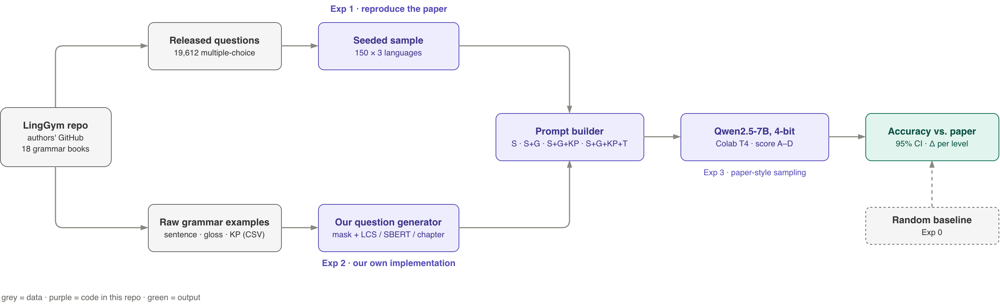

# LingGym reproduction: Hacker & Implementer

A small, from-scratch reproduction of

> Changbing Yang, Franklin Ma, Freda Shi, Jian Zhu. **LingGym: How Far Are LLMs from Thinking Like Field Linguists?** EMNLP 2025, pp. 1314–1340. [paper](https://aclanthology.org/2025.emnlp-main.69/) · [authors' repo](https://github.com/changbingY/LingGym)

**The paper in one paragraph.** The authors take example sentences (interlinear glossed text, IGT) from
18 grammar books of low-resource languages, hide one word, and ask an LLM to pick the right word + gloss
from 4 options. They give the model more and more help: the sentence only (**S**), plus the word-by-word
gloss (**G**), plus the grammar explanation from the book (**KP**, "knowledge point"), plus the English
translation (**T**). Accuracy climbs with every hint (Qwen2.5-7B: 33% → 42% → 56% → 71%; chance is 25%).

**What this repo does.**

| | Paper | This reproduction |
|---|---|---|
| Data | 19,612 questions, 18 languages | seeded sample of 150 questions × 3 languages (Pichi, Papuan Malay, Kalamang) |
| Questions | authors' generator | **Exp 1** authors' released questions · **Exp 2** questions from **our own generator** (`src/question_gen.py`) |
| Model | 10 LLMs | Qwen2.5-7B-Instruct, 4-bit, on a free Colab T4 |
| Answer extraction | sample text (T=0.7), parse letter | read the next-token score of A/B/C/D (**Exp 3** also runs the paper's sampling setup) |
| Levels | S, S+G, S+G+KP, S+G+KP+T | same (all 8 combinations with `levels="all"`) |



---

## Repository layout

```
linggym-repro/
├── README.md
├── requirements.txt          # versions used for our results
├── requirements-colab.txt    # minimal installs on top of Google Colab
├── notebook/linggym_reproduction.ipynb  # ★ the whole pipeline in one notebook: data → our generator → live demo → experiments → results
├── src/                      # all the algorithm code, imported by the notebook
│   ├── seed.py               # fixes random / numpy / torch seeds
│   ├── data.py               # parses the authors' released questions
│   ├── question_gen.py       # ★ our own question generator (mask + 3 distractor types)
│   ├── prompts.py            # ★ prompt template for S / S+G / S+G+KP / S+G+KP+T
│   ├── evaluate.py           # ★ model loading, A-D scoring, paper-style sampling, resume
│   ├── experiment.py         # runs one experiment and saves config + environment
│   └── analysis.py           # accuracy, 95% bootstrap CI, comparison to paper, plot
├── data/
│   ├── raw/                  # (git-ignored) downloaded LingGym repo
│   └── processed/            # the exact question sets we evaluated (committed)
├── results/
│   ├── reference/            # paper's Table 3 and Appendix B numbers, typed in as CSV
│   └── <run>/                # predictions.csv, accuracy.csv, config.json, environment.json
└── figures/
```

★ = core code.

---

## How to reproduce

Everything runs from **`notebook/linggym_reproduction.ipynb`**. Each experiment has its own labelled section:

| Notebook section | Result it produces |
|---|---|
| Part 1 · Data | `data/processed/released_sample.jsonl` (150 questions × 3 languages, seeded) |
| Part 2 · Our question generator | `data/processed/own_questions.jsonl` |
| Part 4 · Exp 0 | `results/exp0_random/`: random baseline |
| Part 4 · Exp 1 | `results/exp1_released_qwen7b/`: Qwen2.5-7B on the authors' questions |
| Part 4 · Exp 2 | `results/exp2_own_qwen7b/`: Qwen2.5-7B on our generator's questions |
| Part 4 · Exp 3 | `results/exp3_released_qwen7b_sampling/`: paper-style sampling, 50 per language |
| Part 5 · Results | `results/comparison.csv`, `figures/results_vs_paper.png` |

All settings (seed, languages, sample size, model, quantization, data version) are in the **Settings** cell
at the top. Every experiment saves its predictions after each batch, so if the run stops, re-running the
notebook resumes where it left off.

### In Google Colab (recommended, free T4 GPU)

1. Set `REPO_URL` in the first cell of `notebook/linggym_reproduction.ipynb` to this repo's GitHub URL.
2. Open `notebook/linggym_reproduction.ipynb` in Colab (File → Open notebook → GitHub).
3. **Runtime → Change runtime type → T4 GPU**.
4. **Runtime → Run all.** The first cell clones the repo and installs `requirements-colab.txt`.
   The model download (~5 GB) takes a few minutes; then Exp 0–3 take ~30–40 minutes in total.
5. The last cell downloads `results.zip` (`results/`, `figures/`, `data/processed/`).

### On your own machine (NVIDIA GPU with ≥ 12 GB)

```bash
pip install -r requirements.txt
jupyter notebook notebook/linggym_reproduction.ipynb   # then Run All
```

Handy changes in the Settings cell: `N_PER_LANGUAGE = 20` for a quick test, `MODEL = "Qwen/Qwen2.5-1.5B-Instruct"`
for a smaller model, `QUANTIZATION = "none"` for full precision. For the paper's 8-way ablation (Table 4), pass
`levels="all"` to `run_experiment`.

### Reproducibility checklist

- **Seeds:** `src/seed.py` seeds `random`, `numpy`, `torch` (+CUDA) and turns on cuDNN determinism; the notebook calls `set_seed(SEED)` before anything else. The seed is also stored in `results/<run>/config.json`.
- **Data version:** the notebook checks out a fixed commit of the authors' repo (`DATA_COMMIT` in Settings); the processed question files are committed in `data/processed/`.
- **Library versions:** `requirements.txt` (versions from our Colab run) and `results/<run>/environment.json` (versions + GPU of each actual run). The notebook also saves `results/colab_pip_freeze.txt`.
- **Determinism:** scoring mode has no sampling. Position ids are set explicitly so left padding (batch size) doesn't shift the input. Different GPU models can still differ in the last decimal place of a logit.

---

## Results

Qwen2.5-7B-Instruct (4-bit) on a Colab T4, 150 questions each from Pichi, Papuan Malay and Kalamang.
*Paper (matched)* = the paper's Appendix B numbers for these 3 languages. Δ = ours − paper (matched).
All numbers are accuracy (%) from `results/comparison.csv` and `results/exp*/accuracy.csv`.

| Level | Paper (all 18) | Paper (matched) | Exp 1: released questions | Δ | Exp 2: our questions | Δ | Exp 0: random |
|---|---|---|---|---|---|---|---|
| S | 33.0 | 33.4 | 34.2 | +0.9 | 29.9 | −3.5 | 26.9 |
| S+G | 41.6 | 41.5 | 40.2 | −1.3 | 35.9 | −5.6 | 26.4 |
| S+G+KP | 56.1 | 60.4 | 60.7 | +0.3 | 52.9 | −7.5 | 22.2 |
| S+G+KP+T | 71.1 | 75.6 | 75.8 | +0.2 | 69.2 | −6.4 | 23.1 |


**What this shows**
- **Exp 1 reproduces the paper.** On the authors' questions we are within 1.3 points of the paper at every level, and the paper's number is inside our 95% confidence interval every time.
- **Same trend as the paper:** accuracy rises with every hint (34 → 40 → 61 → 76%), well above random guessing (22–27%).
- **Exp 2: our generator makes harder questions** (3–7 points lower). Across all levels, the model's wrong answers were mostly our LCS (386) or Sentence-BERT (373) distractors rather than the random chapter one (191), so those two strategies make convincing wrong options. We also mask the answer in the grammar explanation more thoroughly (see below), which likely removes some free hints.
- **Exp 3: our scoring shortcut doesn't change the result.** On the same 150 questions, the paper's sampling method and our scoring method are within 3 points at every level, and no sampled reply was unparseable:

| Level | Scoring (ours) | Sampling (paper's method) |
|---|---|---|
| S | 32.0 | 29.3 |
| S+G | 42.0 | 40.0 |
| S+G+KP | 57.3 | 58.0 |
| S+G+KP+T | 74.7 | 74.0 |

Per-language results are in `results/exp*/accuracy_by_language.csv`.

---

## Differences from the paper (why our numbers can differ)

1. **Sample, not the full benchmark.** 450 questions instead of 19,612, so each accuracy has a ±4-point 95% CI (reported in `comparison.csv`). We compare against the paper's per-language numbers for the same 3 languages, not only the all-language average.
2. **4-bit quantization.** The paper ran Qwen2.5-7B in fp16 on A6000 GPUs; we use NF4 4-bit to fit a 16 GB T4.
3. **Answer extraction.** The paper samples a reply (temperature 0.7, top-p 0.9, repetition penalty 1.1, up to 2048 tokens) and reads the letter. We take the highest-scoring letter token (deterministic, can't fail to parse). Exp 3 runs the paper's way on a subset to measure the effect.
4. **Prompt formatting.** We follow Figure 4 of the paper (including the `Options:` header and an instruction sentence that matches the hint level). The authors' released question files use one fixed instruction for every level.
5. **Our generator vs. the authors'.** Written from the paper's description (§4.2):
   - *LCS distractor:* the paper says the LCS is computed on the **gloss**; the authors' released script computes it on the **word form**. We follow the paper text.
   - *Masking:* we mask the target word and gloss in the knowledge point case-insensitively at word boundaries (the released files sometimes leave a capitalised copy, e.g. *Di* when the answer is *di*).
   - *Filtering:* the authors drop some targets (e.g. words containing "."), so our generator finds more candidate targets than the paper's Table 1 (compared in notebook Part 2).
   - *Gloss cleanup:* we strip sentence punctuation copied onto glosses ("talk." → "talk").

## Challenges and solutions

| Challenge | Solution |
|---|---|
| 7B model in fp16 (~15 GB) doesn't fit a free 16 GB T4 with activations | 4-bit NF4 loading via bitsandbytes (~5.5 GB) |
| Sampled replies are random, slow, and sometimes not a single letter | Score the A/B/C/D next-token logits instead; keep sampling as Exp 3 for comparison |
| Colab sessions disconnect during long runs | Predictions are appended to CSV after every batch; re-running resumes |
| Each grammar uses LaTeX differently (bold on the morpheme line vs. the orthography line in Fwe; bold on part of a word in Kalamang) | Parser accepts both lines and treats a word as a target if any morpheme is bold |
| Duplicate options: one word can have two glosses (*bíg* = "big" / "be.big") | Distractor search skips glosses whose word is already an option; notebook Part 2 asserts all 4 words and glosses are distinct |
| Sentence-BERT can't download on machines without Hugging Face access | Automatic TF-IDF fallback (logged as `embedding_backend` in each question) |
| Answer may still leak through the hints | Measured in the notebook, Part 1 (how often the answer word is still visible in the KP / translation, per language) |

## Credits

- **Data and task:** LingGym by Yang et al. (2025): authors' repo under MIT; grammar texts from Language Science Press under CC BY 4.0. Downloaded at run time; not redistributed here except our processed sample of questions.
- **Backbone libraries:** Hugging Face `transformers` + `accelerate`, `bitsandbytes` (4-bit), `sentence-transformers` (`paraphrase-MiniLM-L6-v2`, the same model the authors' script uses), scikit-learn, pandas, matplotlib.
- **Model:** Qwen2.5-7B-Instruct (Qwen team, Apache 2.0).
- All code in `src/` and the notebook was written for this reproduction. We read the authors' scripts only to check the SBERT model name and the released file format.

## Citation

```bibtex
@inproceedings{yang-etal-2025-linggym,
  title     = {{L}ing{G}ym: How Far Are {LLM}s from Thinking Like Field Linguists?},
  author    = {Yang, Changbing and Ma, Franklin and Shi, Freda and Zhu, Jian},
  booktitle = {Proceedings of the 2025 Conference on Empirical Methods in Natural Language Processing},
  year      = {2025},
  pages     = {1314--1340},
  doi       = {10.18653/v1/2025.emnlp-main.69}
}
```
